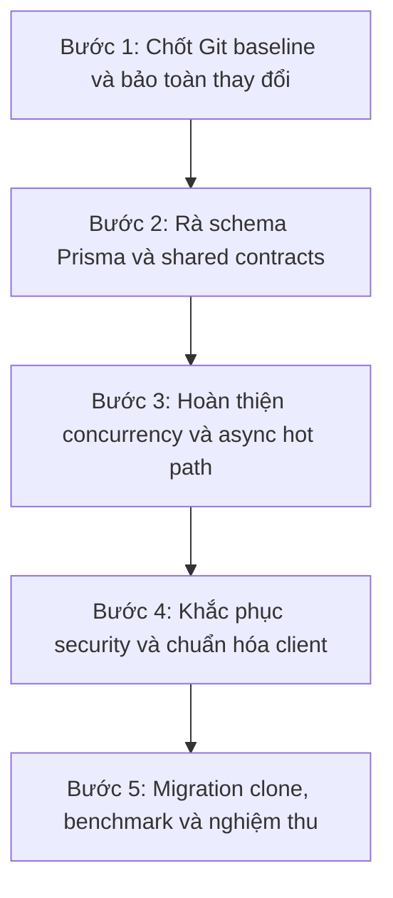

# BÁO CÁO PHÂN TÍCH KIẾN TRÚC VÀ PHƯƠNG ÁN HỢP NHẤT HỆ THỐNG GPS ATTENDANCE (UNIFIED V2.0)

**Mã tài liệu:** `Phan_Tich_He_Thong.md`
**Trạng thái kiểm chứng:** Đã fetch `origin/main` (tip `77e238a`), rà soát working tree (HEAD `5bb193f`) và chạy thử burst load test cục bộ. Chưa merge hoặc commit.

> Báo cáo phân biệt tính năng đã kiểm chứng trong working tree với nội dung đề xuất hoặc chưa xác minh nguồn gốc A/B. Số liệu hiệu năng là kết quả trong môi trường local, không phải cam kết SLA production.

## PHẦN I: TỔNG QUAN HỆ THỐNG VÀ HIỆN TRẠNG MÃ NGUỒN

### 1.1. Bối cảnh và luồng nghiệp vụ

GPS Attendance là monorepo pnpm gồm backend NestJS, dashboard React/Vite, mobile Expo và package TypeScript dùng chung. Luồng nghiệp vụ chính:

1. **Thiết lập danh mục:** quản lý Location Registry gồm Campus, Building và Room; đồng thời quản lý Course, AcademicTerm, CourseSection, ClassEnrollment và TimetableSlot. Building lưu tọa độ, bán kính geofence, các ngưỡng GPS và trạng thái xác minh.
2. **Khởi tạo phiên:** người có quyền chọn lớp học phần, ca học và địa điểm để tạo AttendanceSession; backend lấy roster và khởi tạo attendance records.
3. **Check-in:** mobile lấy tọa độ, accuracy, timestamp, cờ mock location, device ID và integrity payload rồi gửi yêu cầu check-in.
4. **Thẩm định:** backend kiểm tra phiên, enrollment, thiết bị và tín hiệu vị trí/integrity; kết quả có thể là `VALID`, `REVIEW` hoặc `REJECTED`. Bản ghi được ghi nhận cho kết quả `VALID` và `REVIEW`; các trường hợp review có luồng để nhân sự xem xét.

Tọa độ, accuracy, timestamp và mock flag được gửi từ client. Backend tính lại khoảng cách từ dữ liệu nhận được, nhưng không tự đo vị trí thiết bị. Integrity payload hiện chưa được xác minh chữ ký provider độc lập tại server.

### 1.2. Trạng thái Git và phạm vi của báo cáo

| Ref | Tip quan sát được | Trạng thái |
|---|---|---|
| Branch hiện tại `2312718_PhamNguyenNgocPhuoc_KiemThu` | `5bb193f` | HEAD của workspace |
| `origin/main` (`xuanmanhneee/gps-attendance`) | `77e238a` | Đã fetch; có 48 commit chỉ ở origin và 24 commit chỉ ở HEAD |
| `new-origin/main` (`Bee-Max-Ne/H-Th-ng-i-m-Danh-Th-ng-Minh`) | `b07c32f` | Ref local từ snapshot trước, chưa fetch lại trong lần cập nhật này |

Theo thống kê ancestry đã thực hiện, diff từ merge-base tới HEAD so với `origin/main` là 298 file (+29.740/-4.668); so với `new-origin/main` là 384 file (+43.952/-2.597). Đây là thống kê thay đổi, không thay thế việc review semantic từng commit.

Index và working tree đã có các thay đổi từ trước. Báo cáo và `nginx.conf` hiện là file untracked trong trạng thái quan sát được; không chạy `git add`, `git commit`, `git pull` hoặc merge trong lần hoàn thiện này. Lịch sử HEAD có một số merge commit cũ mang thông điệp hợp nhất `origin/main`, nhưng tip `origin/main` hiện tại (`77e238a`) không phải tổ tiên của HEAD. Vì vậy không thể coi các merge cũ là bằng chứng rằng các commit mới nhất của `origin/main` đã được đưa vào working tree.

**Phạm vi lấy code từ `main`:** lần thao tác được xác nhận trong phiên này là fetch ref `origin/main` đến `77e238a`; không có merge, pull hoặc cherry-pick các commit từ tip đó. Do đó, chưa có danh sách file nào có thể khẳng định là được lấy từ lần fetch này. Các chức năng đang có trong working tree được mô tả theo trạng thái code hiện tại, không gán nguồn gốc cho `origin/main` khi chưa đối chiếu commit cụ thể.

## PHẦN II: ĐỐI CHIẾU THÀNH PHẦN GIỮA HAI DỰ ÁN (A VS B)

> Cách phân vai A/B dưới đây lấy từ khung nội dung đầu vào. Chưa có SHA/tag cụ thể cho từng phiên bản A và B để xác nhận độc lập nguồn gốc từng tính năng hoặc tỷ lệ đóng góp.

| Phân hệ / tiêu chí | Hệ thống A theo tài liệu đầu vào | Hệ thống B theo tài liệu đầu vào | Đã kiểm chứng trong working tree | Định hướng hợp nhất |
|---|---|---|---|---|
| Concurrency engine | Redis buffer và ba thao tác Lua nguyên tử | Được mô tả là ưu tiên nghiệp vụ và ghi PostgreSQL | Có `RedisAttendanceRecordBuffer` và `MARK_PRESENT_SCRIPT`, `BEGIN_SESSION_FLUSH_SCRIPT`, `COMPLETE_SESSION_FLUSH_SCRIPT`; chưa xác nhận nguồn gốc commit A | Giữ buffer, kiểm thử race/retry và giảm các thao tác PostgreSQL đồng bộ còn lại |
| Job scheduler | Redis ZSET scheduler và flush | Được mô tả là scheduler/luồng phiên từ code thực tế | Có `RedisJobSchedulerService`, ZSET, lease/retry; flush theo `closeAt` hoặc lúc đóng/hủy session | Giữ scheduler; chưa có bằng chứng roster được prewarm trước 5 phút |
| Location Registry và học vụ | Theo khung, tọa độ/phiên linh hoạt hơn | Theo khung, Campus → Building → Room và academic core | Có registry, Course, AcademicTerm, CourseSection, ClassEnrollment và TimetableSlot trong schema/backend | Giữ registry/học vụ; kiểm tra migration trên DB clone trước khi phát hành |
| Geo-location | Theo khung, Haversine và kiểm tra vùng biên | Theo khung, validation từ phiên bản thực tế | Có Haversine, phân loại `INSIDE`/`OUTSIDE`/`UNCERTAIN`, các kiểm tra mock/integrity và confidence scoring | Giữ decision tree, đặc biệt xử lý trạng thái vùng biên `UNCERTAIN` |
| Mobile/Admin | Theo khung, UI cơ bản | Theo khung, Expo và dashboard quản trị | Có Expo Router, màn hình check-in `attendance/[id]`, Location Registry, tạo session và luồng xem/xử lý review | Giữ các luồng hiện có, rà lại contract giữa các client và backend |
| Security/integrity | Theo khung, có freshness rule | Theo khung, một số guard/integrity cần rà soát | Student check-in chưa áp dụng timestamp freshness; route `POST /v0/users/test-filter` chưa được bảo vệ; integrity chưa xác minh chữ ký provider | Khắc phục từng endpoint theo policy và hoàn thiện freshness/integrity phù hợp threat model |
| Load test | Theo khung, có concurrency engine | Theo khung, có benchmark và nghiệp vụ học vụ | Có k6 scripts và đã chạy burst cục bộ; luồng lưu/flush đủ 1.000 records nhưng SLA latency chưa đạt | Dùng bài test có kiểm soát làm điều kiện trước khi tuyên bố capacity |

### 2.1. Nội dung có ở tip `origin/main` đã fetch nhưng chưa nhập vào HEAD

Các commit dưới đây xuất hiện trong lịch sử tip `origin/main` quan sát được. Đây là **danh sách nội dung để xem xét khi hợp nhất**, không phải danh sách code đã lấy vào branch hiện tại:

| Commit trên `origin/main` | Nội dung theo commit message | Trạng thái đối với lần fetch hiện tại |
|---|---|---|
| `77e238a` | Hoàn thiện luồng review điểm danh và audit | Chưa merge/cherry-pick từ tip này |
| `20d472c`, `8920023` | Chặn check-in khi session đang flush; chỉ acknowledge Redis job sau xử lý thành công | Chưa merge/cherry-pick từ tip này |
| `0d6e3bc`, `0a0d574`, `ba9d2b8` | Kiểm tra dữ liệu vị trí check-in, timestamp freshness và giới hạn attempt | Chưa merge/cherry-pick từ tip này |
| `74bbdbd`, `f9dc6eb` | Ghi attendance/device atomic hơn và bổ sung load-test harness cô lập | Chưa merge/cherry-pick từ tip này |
| `61947aa`, `3596e61`, `d56979b` | Chỉnh sửa phiên, cải thiện wizard tạo phiên và tra cứu attendance trên dashboard | Chưa merge/cherry-pick từ tip này |
| `67b5943`, `c49dcda`, `f32cd3e` | Refresh access token trên mobile và refresh-token/remember-login | Chưa merge/cherry-pick từ tip này |
| `38f7d30`, `4bc3db5`, `92557a5` | Chuẩn bị roster khi phiên sắp mở, xem trước người tham gia và đổi role sang `organizer`/`participant` | Chưa merge/cherry-pick từ tip này |

Commit message chỉ cho biết ý định ở commit; trước khi nhập cần đọc diff và kiểm tra phần tương ứng trong working tree, vì có thể đã tồn tại triển khai tương tự từ nhánh khác.

### 2.2. Vấn đề của A/B và kết quả xử lý trong working tree

Phân loại A/B dưới đây bám theo mô tả người dùng cung cấp; chưa có SHA/tag độc lập cho hai phiên bản để xác nhận chính xác từng phần thuộc A hay B.

| Thành phần / vấn đề được nêu | Trạng thái trước hoặc rủi ro | Kết quả hiện tại |
|---|---|---|
| A — Redis Write-Behind và ba Lua script | Check-in có nguy cơ dồn ghi attendance vào PostgreSQL khi tải burst | Buffer Redis, Lua atomic và flush theo batch đã có trong working tree. Hai lượt burst hậu tích hợp ghi nhận 1.000/1.000 check-in và xác minh flush đủ record; latency p95 2,79 giây và 15,71 giây, chưa đạt mục tiêu `<50 ms`. |
| A — phân phối nhiều API replica | Nginx upstream tĩnh từng không resolve kịp backend replica, gây 77 HTTP 502 trong lượt đầu | Đã đổi upstream sang phân giải Docker DNS động; hai lượt tiếp theo không có HTTP failure và log ghi nhận cả ba replica nhận request. |
| A/B — kết quả thẩm định bị mất khi ghi attendance | `VALID`/`REVIEW` đã tính ở check-in nhưng không được truyền đầy đủ vào lời gọi lưu attendance record | Đã truyền `finalStatus` và `reasons` tới buffer; regression test xác nhận cả `VALID` và `REVIEW`. |
| B — học vụ và Location Registry | Cần ràng buộc phiên với lớp, roster, lịch và địa điểm | Schema/backend hiện có Course, AcademicTerm, CourseSection, ClassEnrollment, TimetableSlot và Campus/Building/Room; được giữ lại trong working tree. |
| B — Mobile/Admin | Cần luồng client thực tế cho check-in, tạo phiên, địa điểm và review | Các route Expo và dashboard tương ứng đang có; một số lỗi tích hợp khi chạy (import path, AuthProvider) đã được sửa và web export kiểm tra thành công. |
| Vận hành local — CORS trỏ nhầm service | Ngrok và dashboard từng gọi cổng `3000`, nhưng cổng đó phục vụ ứng dụng khác | Dev backend/ngrok chuyển sang `3001`; script kiểm tra và thay đúng tunnel domain bị trỏ sai. Đã xác nhận backend health HTTP 200, preflight từ `localhost:5173`/`localhost:8081` HTTP 204; dashboard login tới API và nhận HTTP 401 với tài khoản thử không hợp lệ thay vì lỗi CORS. |
| Role cũ `student`/`lecturer` trong DB | Prisma hiện khai báo `participant`/`organizer`; dữ liệu role cũ gây lỗi đọc user | Đã tạo migration ánh xạ role cũ sang role trung tính và validate/build thành công. **Migration chưa được chạy trên DB**, nên lỗi dữ liệu runtime chưa thể xem là đã khắc phục. |
| Timestamp freshness cho student check-in | Chưa xác nhận được nhánh check-in sinh viên gọi validator freshness | Chưa xác nhận đã xử lý trong working tree; giới hạn 120 giây/30 giây chỉ nằm trong checker hiện có/được đề xuất, cần kiểm tra luồng gọi và test. |
| Device attestation, accuracy null, route test không guard, roster prewarm 5 phút | Còn khoảng trống về xác minh provider, fallback vị trí, quyền route và tải khởi tạo roster | Chưa được xem là đã khắc phục; cần xử lý và kiểm thử riêng trước khi tuyên bố hoàn tất bảo mật hoặc chịu tải. |

Tỷ lệ “70% từ B + 30% từ A” là quy tắc đề xuất trong tài liệu đầu vào, không phải tỷ lệ đã đo theo code, commit hoặc module. Chỉ nên kết luận tỷ lệ sau khi xác định SHA đại diện cho A/B và có phương pháp thống kê rõ ràng.

## PHẦN III: PHÂN TÍCH RỦI RO BẢO MẬT VÀ THIẾU SÓT KỸ THUẬT

> Đây là các vấn đề cần rà soát/khắc phục theo bằng chứng hiện có. Báo cáo không tự gán mức “P0” nếu chưa có threat model, đánh giá khả năng khai thác và phạm vi ảnh hưởng tương ứng.

1. **Student check-in chưa kiểm tra độ tươi timestamp GPS**
   - DTO nhận timestamp, nhưng nhánh check-in sinh viên chưa áp dụng `LocationTimestampCheck`. Check timestamp hiện có ở luồng khác không đồng nghĩa mọi check-in đã được kiểm tra freshness.
   - `LocationTimestampCheck` đang định nghĩa tuổi vị trí tối đa 120 giây và độ lệch tương lai tối đa 30 giây. Áp dụng cho student check-in cần được triển khai và kiểm thử rõ ràng.
2. **Device integrity chưa xác minh chữ ký server-side**
   - Mobile có thể tạo integrity payload, backend đánh giá dữ liệu đầu vào nhưng chưa xác minh verdict với Play Integrity/App Attest provider.
   - Không coi giá trị do client tự gửi là chứng cứ phần cứng đã được xác nhận. Nếu threat model yêu cầu, cần thiết kế provider verification cùng nonce/challenge.
3. **Accuracy GPS null được xử lý không nhất quán**
   - Helper `services/location.ts` dùng fallback `9999`; màn hình active `attendance/[id].tsx` có nhánh biến accuracy null thành `0`.
   - Backend validation cũng chuẩn hóa accuracy null thành `0` ở một nhánh. Cần thống nhất policy để dữ liệu thiếu không bị hiểu nhầm là chính xác; ngưỡng loại bỏ cụ thể cần được xác nhận với thiết bị thực và DTO.
4. **Route và quyền truy cập cần rà soát**
   - `POST /v0/users/test-filter` chưa có guard trong controller; các route khác cần được đánh giá theo từng endpoint. Một số route user/account đã dùng guard, do đó không thể kết luận toàn bộ controller đều đang mở.
   - Xác định quyền tối thiểu cho từng thao tác; không gắn blanket role nếu có khác biệt nghiệp vụ. Xóa route test sau khi xác nhận không còn mục đích sử dụng.
5. **Check-in chưa là một giao dịch nguyên tử duy nhất**
   - Lua script bảo đảm tính nguyên tử cho thao tác trên Redis attendance buffer. Attempt, registered device, integrity check, history và audit vẫn có các thao tác PostgreSQL riêng.
   - Cần kiểm thử race/retry và xác định dữ liệu nào bắt buộc ghi đồng bộ, dữ liệu nào có thể chuyển sang background queue với bảo đảm durability, thứ tự và deduplication.

## PHẦN IV: KIẾN TRÚC VÀ KẾT QUẢ KIỂM THỬ CHỊU TẢI (>1.000 CHECK-IN)

### 4.1. Kiến trúc có trong working tree

```text
       [ Check-in clients / k6 ]
                  |
                  v
       [ Nginx Load Balancer ]
                  |
       +----------+----------+
       |          |          |
       v          v          v
   [NestJS 1] [NestJS 2] [NestJS 3]
       |          |          |
       +----------+----------+
                  |
          +-------+-------+
          |               |
          v               v
 [Redis attendance buffer] [PostgreSQL]
          |
          +---- scheduler / snapshot flush ---> PostgreSQL
```

- Check-in ghi attendance record vào Redis Hash qua Lua script, bảo đảm thao tác ghi/claim device nguyên tử trên Redis.
- Khi session đến `closeAt`, hoặc được đóng/hủy, `RedisJobSchedulerService` chạy job flush. Buffer được khóa, snapshot được ghi xuống PostgreSQL theo batch 100; buffer chỉ được xóa sau khi DB ghi thành công.
- Scheduler dùng Redis ZSET, tick mỗi 10 giây, lease và retry/backoff. Không tìm thấy cơ chế `ROSTER_INIT_BUFFER_MS` hoặc roster prewarm 5 phút; roster hiện được ghi vào buffer lúc tạo session.
- Buffer chỉ thay thế phần ghi attendance record khỏi đường ghi đồng bộ. Session lookup, attempt create/count/complete, registered-device upsert, integrity checks, duplicate-device queries, history và audit vẫn có thao tác PostgreSQL đồng bộ.

### 4.2. Benchmark baseline một API instance

Kết quả baseline local trước burst integration: 313 VU đạt p95 32,48 ms; 315 VU có p95 1,13 giây và trượt tiêu chí p95 1 giây; 314 VU chưa đo. Đây là benchmark của baseline cũ, không phải capacity đã nghiệm thu cho working tree hiện tại.

### 4.3. Burst test 1.000 request qua ba API replicas

k6 được cấu hình 100 arrival/giây trong cửa sổ 10 giây, tổng cộng 1.000 check-in duy nhất. Requests hoàn tất sau cửa sổ gửi tải; không diễn giải con số 1.000 thành 1.000 kết nối đồng thời được duy trì cùng lúc.

| Cấu hình | Accepted | HTTP failure / dropped | Throughput toàn lượt | p95 / median | Quan sát tài nguyên |
|---|---:|---:|---:|---:|---|
| 3 API (mỗi API 2 CPU/2 GB), PostgreSQL 2 CPU/2 GB, Redis 1 CPU/512 MB | 1.000/1.000 | 0% / 0 | 90,95 req/s | 2,79 s / 2,09 s | API khoảng 114–126% CPU mỗi replica ở các mẫu; PostgreSQL khoảng 189–197% |
| Cùng API/Redis, PostgreSQL 4 CPU/2 GB | 1.000/1.000 | 0% / 0 | 42,66 req/s | 15,71 s / 12,99 s | PostgreSQL có mẫu tới 461%; kết quả biến động, không chứng minh tăng CPU cải thiện SLA |

Mục tiêu p95 `<50 ms` chưa đạt ở cả hai lượt. Giá trị CPU từ `docker stats` là tỷ lệ theo một core và chỉ là mẫu ngắn, không phải time-series đầy đủ.

Lượt chạy đầu với cấu hình Nginx upstream tĩnh phát sinh 77 HTTP 502 do Nginx tạm không thấy upstream khả dụng. Sau khi đổi sang dynamic Docker-DNS upstream, hai lượt sau có 0 HTTP failure; log lượt gần nhất cho thấy cả ba replica nhận request.

### 4.4. Kiểm chứng dữ liệu và validation

- `verify-load.ts` trước flush xác nhận 1.000 attendance records, cả 1.000 là `present` trong Redis và PostgreSQL chưa có record tương ứng.
- Sau khi kích hoạt job flush, verifier xác nhận Redis buffer rỗng và PostgreSQL có đủ 1.000 record `present`.
- Validation đã chạy: shared build và attendance backend build thành công; test mục tiêu cho check-in đạt 3/3; một lượt targeted test trước đó đạt 30 tests, 6 suites pass, 1 suite skipped và 3 tests skipped.
- Migration đã chạy trên database hiệu năng cô lập; đây chưa phải rehearsal trên bản sao staging/production.

**Kết luận hiệu năng:** working tree đã chứng minh luồng ghi buffer và flush 1.000 bản ghi hoạt động trong bài thử cục bộ, nhưng **chưa đạt SLA latency 50 ms và chưa chứng minh năng lực production**.

## PHẦN V: CẤU TRÚC VÀ THÀNH PHẦN MÃ NGUỒN HIỆN CÓ

### 5.1. Thành phần ứng dụng và thư viện dùng chung

- **Shared package (`packages/shared`):** có `ApiResponse<T>` dạng success/error union, error codes, các API types và `FetchHttpClient`. HTTP client hỗ trợ Bearer token tùy theo token provider, timeout 30 giây và `ApiError`; chưa có căn cứ để khẳng định mọi endpoint đã chuẩn hóa đồng nhất.
- **Backend (`server/attendance`):** NestJS modules cho account/auth, users, units, location registry, attendance sessions, check-in, attendance records, validation và job scheduler.
- **Mobile (`client/mobile-client`):** Expo Router; màn hình chính liệt kê phiên, `attendance/[id].tsx` là luồng check-in active. Có dịch vụ lấy vị trí, device ID và integrity; route active hiện biến accuracy null thành `0`.
- **Admin (`client/admin-dashboard`):** React/Vite; có trang Location Registry, tạo session và màn hình attendance records/review.

### 5.2. Định danh, validation và cơ sở dữ liệu

- Role trong Prisma hiện tại là `admin`, `organizer`, `participant`. JWT request và định danh User/Account là hai khái niệm cần theo đúng contract; không suy luận hai loại ID có thể dùng thay thế cho nhau.
- Location validation dùng Haversine để tính khoảng cách, sau đó phân loại: `OUTSIDE` khi `distance - accuracy > radius`; `INSIDE` khi `distance + accuracy <= radius`; các trường hợp còn lại là `UNCERTAIN`. `UNCERTAIN` được xử lý theo các tín hiệu khác, có thể đưa vào `REVIEW` hoặc `REJECTED`.
- Confidence scoring có các trọng số LOCATION 40, MOCK 25, INTEGRITY 35; ngưỡng chung trong service là `VALID` từ 80 khi không còn lý do cảnh báo, `REVIEW` từ 60, dưới 60 là `REJECTED`. Một số nhánh như mock location, out-of-range, low accuracy và vùng biên có quyết định riêng trước/ngoài phép cộng điểm.
- `LocationTimestampCheck` định nghĩa age tối đa 120 giây và future skew tối đa 30 giây, nhưng chưa được áp dụng trong nhánh student check-in.
- Schema Prisma có các nhóm định danh/tổ chức (`Account`, `RefreshSession`, `User`, `Unit`, `Tag`, `UserTag`), điểm danh/kiểm toán (`AttendanceSession`, `AttendanceRecord`, `AttendanceAttempt`, `AuditLog`), địa điểm (`Campus`, `Building`, `Room`) và học vụ (`Course`, `AcademicTerm`, `CourseSection`, `ClassEnrollment`, `TimetableSlot`). `AttendanceRecord` có unique constraint `[sessionId, userId]`.

### 5.3. Sơ đồ thư mục liên quan

```text
gps-attendance/
├── docker-compose.yml                 # PostgreSQL, Redis, migration, API/Nginx, dashboard
├── docker-compose.perf.yml            # Stack kiểm thử cô lập; ba API replicas
├── nginx.conf                         # Nginx upstream phân giải Docker DNS động
├── pnpm-workspace.yaml
├── packages/
│   └── shared/src/
│       ├── api/                       # FetchHttpClient, ApiResponse, error codes, API types
│       └── types/                     # Attendance, auth, device, units, users
├── server/attendance/
│   ├── prisma/schema.prisma           # Auth, academic, attendance, registry, audit
│   ├── perf/                          # check-in.js, check-in-race.js, benchmark guide
│   ├── scripts/                       # prepare-load.ts, verify-load.ts
│   └── src/
│       ├── account/
│       ├── attendance-check-in/       # Check-in, attempt, device checks, review
│       ├── attendance-record/infra/redis/ # Buffer và Lua scripts
│       ├── attendance-sessions/
│       ├── attendance-validation/     # Geo/location/mock/timestamp checks
│       ├── common/device-attestation/
│       ├── job-scheduler/             # RedisJobSchedulerService (ZSET)
│       ├── location-registry/
│       ├── units/
│       └── users/
└── client/
    ├── admin-dashboard/src/           # Location registry, create session, review
    └── mobile-client/src/
        ├── app/                       # Expo Router screens
        └── services/                  # Location, device ID, integrity
```

Đây là sơ đồ các phần liên quan có trong working tree, không phải khẳng định toàn bộ kế hoạch đã hoàn tất. `sanitizeLocationAccuracy()` dùng thống nhất, student timestamp freshness và server-side provider signature verification chưa được xác nhận là đã triển khai.

## PHẦN VI: LỘ TRÌNH HỢP NHẤT CHI TIẾT (STEP-BY-STEP MERGE PLAN)



### BƯỚC 1: Quản trị Git baseline và phê duyệt SHA

1. `origin/main` đã fetch ở `77e238a`; HEAD hiện là `5bb193f`, phân kỳ 48/24 commit.
2. Chốt repository và SHA baseline chính thức; `origin` và `new-origin` trỏ đến hai repository khác nhau.
3. Bảo toàn các thay đổi staged, unstaged và untracked hiện có. Rà trạng thái index trước khi hợp nhất; không ghi đè hoặc loại bỏ thay đổi của người dùng.
4. Xác minh SHA đại diện cho A/B và tìm tài liệu `He_Thong_Phan_Tich_V1.md` ở đúng ref trước khi gán nguồn gốc tính năng.

### BƯỚC 2: Thống nhất Schema cơ sở dữ liệu và Shared Package

1. Đối chiếu Prisma schema/migration của baseline: giữ các quan hệ Location Registry, academic core và ràng buộc `@@unique([sessionId, userId])` nếu phù hợp với dữ liệu đích.
2. Rà role enum hiện tại `admin`, `organizer`, `participant`, refresh sessions và khác biệt `User.id`/`Account.id`; xác nhận API/JWT/guard cùng migration tương ứng.
3. Đồng bộ `ApiResponse<T>`, error codes và check-in contracts giữa shared, backend, mobile và dashboard; không khẳng định 100% endpoint chuẩn hóa trước khi kiểm kê.

### BƯỚC 3: Hoàn thiện Async Core Concurrency và Two-Phase Flush

1. Giữ buffer/Lua/scheduler trong working tree và kiểm thử race, duplicate device, session flush lock, retry sau lỗi DB và phục hồi khi process dừng giữa hai pha.
2. Đo riêng thời gian từng truy vấn PostgreSQL còn lại trên hot path.
3. Chỉ chuyển attempt/audit/history/device writes sang background queue khi xác định rõ durability, thứ tự, retry, deduplication và yêu cầu audit; Redis List/BullMQ là phương án cần thiết kế, chưa phải triển khai hiện tại.
4. Tối ưu khởi tạo roster: hiện ghi tuần tự vào Redis; chưa có prewarm roster 5 phút trước session.

### BƯỚC 4: Khắc phục bảo mật và chuẩn hóa Client

1. **Auth guards:** rà route cụ thể ở UserController, UnitController, AccountController và LocationController; áp dụng đúng quyền từng endpoint, không blanket guard thiếu phân tích nghiệp vụ.
2. **Timestamp freshness:** triển khai `LocationTimestampCheck` cho student check-in, xác nhận giới hạn age/future-skew và bổ sung tests. Giới hạn 120 giây/30 giây có trong check hiện tại nhưng chưa áp dụng cho nhánh sinh viên.
3. **Accuracy GPS:** thống nhất helper và route active để không biến null thành `0m`; xác nhận ngưỡng accuracy với thiết bị thực và contract backend.
4. **Device integrity:** nếu yêu cầu threat model, triển khai xác minh provider Play Integrity/App Attest phía server; không dùng JSON mock/stub như chứng cứ phần cứng.
5. Kiểm thử lại luồng mobile active và admin review với API contract/schema sau hợp nhất.

### BƯỚC 5: Migration test trên DB clone và benchmark k6 nghiệm thu

1. Tạo database clone/staging; chạy `prisma migrate deploy`, kiểm tra schema/dữ liệu trước-sau và smoke test. Không dùng `migrate reset` trên DB có dữ liệu cần giữ.
2. Chạy k6 qua Nginx với ít nhất ba API replicas và arrival rate được thống nhất; kiểm thử retry, flush và phục hồi sau lỗi.
3. Tiêu chí nghiệm thu đề xuất cần được chủ dự án duyệt trước:
   - Ít nhất 1.000 check-in duy nhất trong cửa sổ 10 giây, không nhầm số iteration với số kết nối đồng thời.
   - 0% HTTP 5xx/502 và không có lỗi cạn connection pool.
   - p95 `<50 ms` nếu đây là SLA đã duyệt.
   - Dữ liệu sau flush khớp 100%, không mất hoặc nhân đôi record.
   - Thu thập CPU/RAM, throughput và latency theo thời gian; ngưỡng CPU cần xác định rõ theo quota/container.

**Kết luận:** `origin/main` đã được fetch nhưng chưa merge. Working tree hiện có Redis buffer, scheduler và kết quả thử nghiệm 1.000 check-in; các thay đổi chưa được commit. Burst cục bộ ghi nhận và flush đủ 1.000 bản ghi nhưng chưa đạt p95 `<50 ms`, vì vậy chưa thể nghiệm thu SLA hoặc tuyên bố năng lực production.
