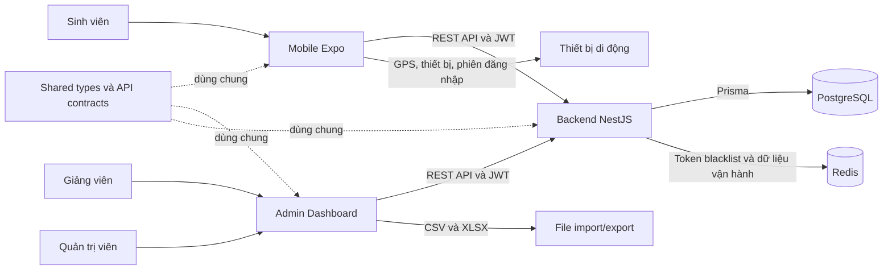
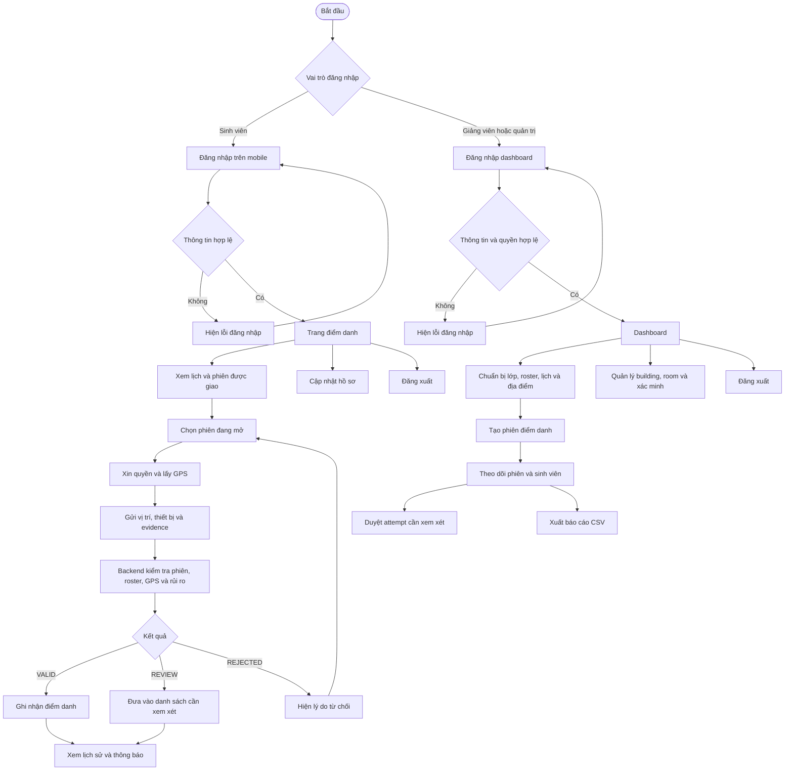
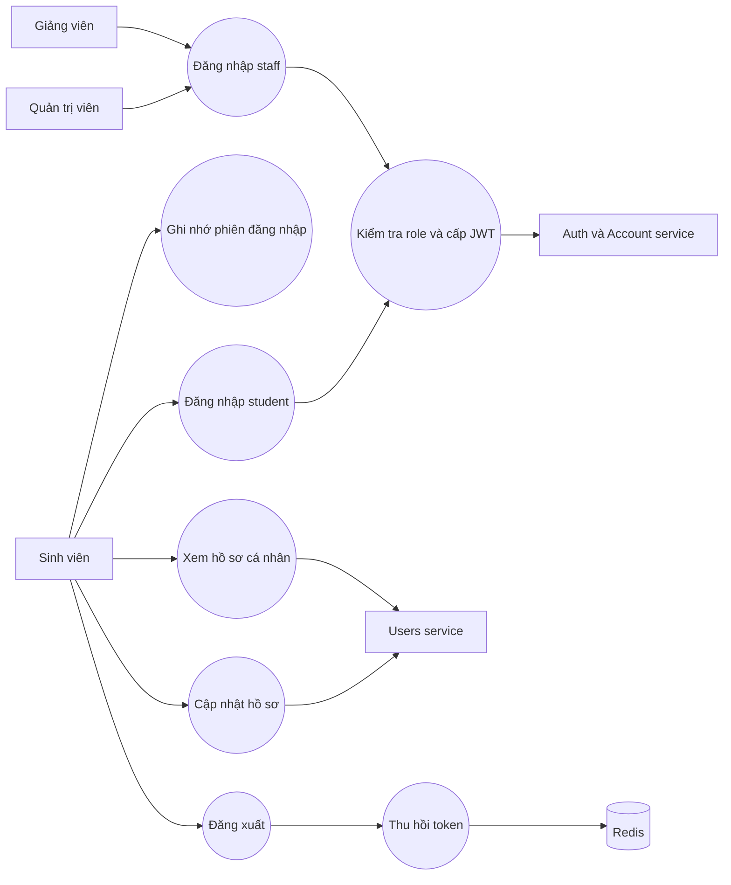
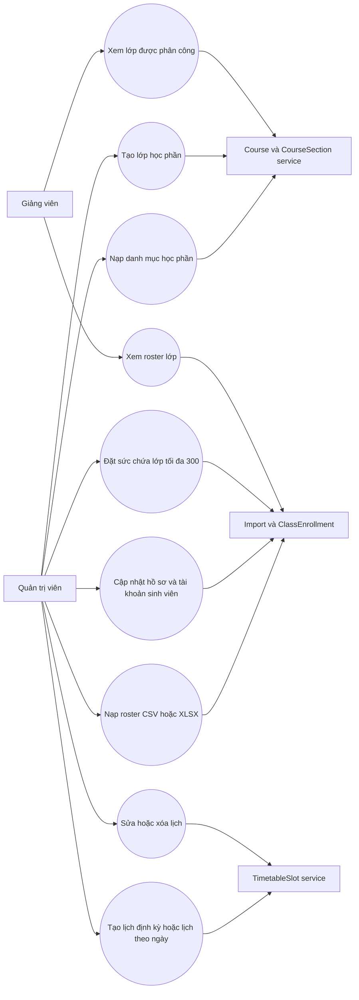
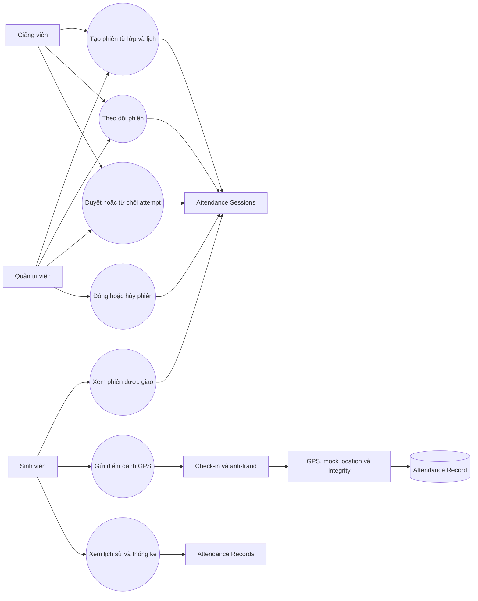
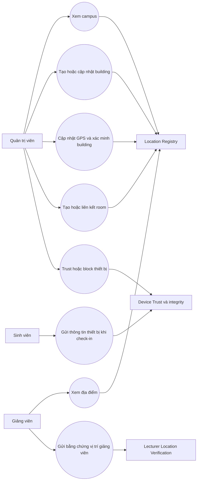
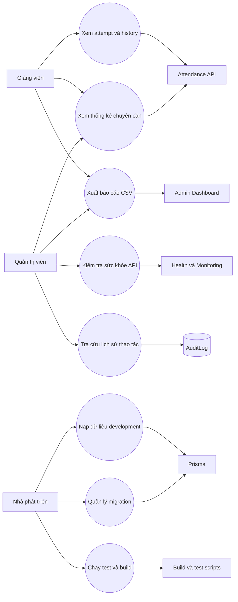

# GPS Attendance System

**Người biên soạn và phụ trách tài liệu: Phạm Nguyễn Ngọc Phước**

> README này mô tả hệ thống theo mã nguồn hiện có trong repository: mục tiêu, thành phần, sơ đồ, use case, cách cấu hình, chạy, kiểm thử và các giới hạn đã biết. Tài liệu không thay thế API Swagger hoặc hướng dẫn chi tiết của từng package.

## Mục lục

1. [Giới thiệu tổng quan](#1-giới-thiệu-tổng-quan)
2. [Cấu trúc hệ thống](#2-cấu-trúc-hệ-thống)
3. [Sơ đồ tổng quan](#3-sơ-đồ-tổng-quan)
4. [Sơ đồ user flow](#4-sơ-đồ-user-flow)
5. [Sơ đồ use case theo chức năng](#5-sơ-đồ-use-case-theo-chức-năng)
6. [Chức năng theo vai trò](#6-chức-năng-theo-vai-trò)
7. [Công nghệ và dữ liệu](#7-công-nghệ-và-dữ-liệu)
8. [Cài đặt và thực thi](#8-cài-đặt-và-thực-thi)
9. [API, cấu hình và vận hành](#9-api-cấu-hình-và-vận-hành)
10. [Bảo mật, giới hạn và lưu ý](#10-bảo-mật-giới-hạn-và-lưu-ý)
11. [Tài liệu liên quan](#11-tài-liệu-liên-quan)

---

## 1. Giới thiệu tổng quan

GPS Attendance là hệ thống điểm danh cho môi trường học tập. Ứng dụng gồm mobile cho sinh viên, dashboard web cho giảng viên/quản trị viên và backend API dùng chung. Dữ liệu nghiệp vụ được lưu bằng PostgreSQL thông qua Prisma.

Mỗi phiên điểm danh gắn với lớp học phần, giảng viên, lịch học, thời gian mở/đóng và vị trí/tòa nhà đã cấu hình. Sinh viên được phân bổ vào phiên sẽ gửi vị trí GPS cùng thông tin thiết bị để backend đánh giá lượt điểm danh. Kết quả có thể là hợp lệ, cần xem xét hoặc bị từ chối.

| Vai trò | Giao diện chính | Nhiệm vụ |
|---|---|---|
| Sinh viên (`student`) | Mobile Expo | Đăng nhập, xem lịch và phiên được phân công, điểm danh GPS, xem lịch sử/thông báo, cập nhật hồ sơ |
| Giảng viên (`lecturer`) | Dashboard web; một số luồng đăng nhập cũng có trên mobile | Xem lớp được phân công, tạo/quản lý phiên của mình, xem roster và kết quả, xử lý lượt cần xem xét |
| Quản trị viên (`admin`) | Dashboard web | Quản lý phiên, lớp học phần, roster, lịch học, địa điểm/tòa nhà/phòng và độ tin cậy thiết bị |

### Phạm vi nghiệp vụ hiện có

- Đăng nhập bằng username/password; backend kiểm tra mật khẩu đã băm bằng bcrypt và phân quyền qua JWT.
- Quản lý hồ sơ người dùng, đơn vị (`Unit`), thẻ (`Tag`) và các tiêu chí chọn sinh viên.
- Tạo lớp học phần, học kỳ, ghi danh và lịch học định kỳ hoặc buổi học theo ngày cụ thể.
- Nhập danh mục học phần và danh sách sinh viên từ CSV/XLSX. Roster cập nhật hồ sơ, email theo MSSV, ngày sinh, giới tính, lớp/khóa; tài khoản mới mặc định dùng MSSV làm username nếu file thiếu username và dùng MSSV làm mật khẩu. Với roster chi tiết, mật khẩu các tài khoản sinh viên đã có trong danh sách cũng được đặt lại thành MSSV.
- Quản lý Location Registry gồm campus, building và room; chỉ dùng vị trí building đã xác minh khi tạo phiên.
- Điểm danh GPS với khoảng cách Haversine, kiểm tra mock location, thiết bị trùng, giới hạn số lần thử và đánh giá integrity evidence.
- Xem lịch sử, thống kê, chi tiết bản ghi/attempt; giảng viên/quản trị viên có thể duyệt hoặc từ chối lượt cần xem xét.
- Audit log, device trust, health check, logging, rate limit và API Swagger.
- Ghi nhớ phiên đăng nhập trên mobile: nếu được chọn, app giữ token/user trong SecureStore (native) hoặc localStorage (web); ứng dụng không lưu mật khẩu.

---

## 2. Cấu trúc hệ thống

Đây là monorepo pnpm. Backend, các client và package chia sẻ contract dùng workspace root. Presentation Slidev là workspace riêng.

```text
gps-attendance-main/
├── README.md
├── package.json                    # Lệnh chạy/build ở root
├── pnpm-workspace.yaml
├── pnpm-lock.yaml
├── docker-compose.yml              # PostgreSQL, Redis, backend, dashboard
├── client/
│   ├── admin-dashboard/            # React/Vite: giảng viên và quản trị viên
│   │   ├── src/
│   │   │   ├── api/                # API client
│   │   │   ├── components/         # Modal, bảng, điều hướng và UI dùng chung
│   │   │   ├── context/            # Trạng thái đăng nhập web
│   │   │   ├── hooks/
│   │   │   └── pages/              # Login, dashboard, phiên, địa điểm, lớp học phần
│   │   ├── Dockerfile
│   │   └── nginx.conf
│   └── mobile-client/              # Expo/React Native: app sinh viên
│       └── src/
│           ├── app/                # Expo Router: tabs, login, profile, attendance
│           ├── api/
│           ├── components/
│           ├── context/
│           ├── hooks/
│           └── services/           # Session/token, device ID và storage
├── packages/
│   └── shared/                     # Types, API response, HTTP client, error codes
├── server/
│   └── attendance/                 # NestJS API
│       ├── prisma/
│       │   ├── schema.prisma
│       │   ├── migrations/
│       │   └── seed.ts
│       ├── src/
│       │   ├── auth/ account/ users/
│       │   ├── attendance-sessions/
│       │   ├── attendance-check-in/
│       │   ├── attendance-validation/
│       │   ├── attendance-record/
│       │   ├── location-registry/ device-trust/
│       │   ├── health/ common/ prisma/ redis/
│       │   └── units/ tags/ geo/
│       └── test/                   # E2E tests
├── docs/
│   └── SYSTEM.md                   # Mô tả kỹ thuật hệ thống
└── presentation/                   # Slidev; workspace/lockfile riêng
```

### Trách nhiệm theo package

| Package | Vai trò |
|---|---|
| `server/attendance` (`@gps-attendance/attendance`) | REST API, xác thực/phân quyền, nghiệp vụ điểm danh, Prisma, migration và seed |
| `client/admin-dashboard` (`@gps-attendance/admin-dashboard`) | Dashboard quản lý và theo dõi phiên, roster, lịch học, địa điểm |
| `client/mobile-client` (`@gps-attendance/mobile-client`) | Ứng dụng di động, GPS check-in, lịch, lịch sử, thông báo và hồ sơ |
| `packages/shared` (`@gps-attendance/shared`) | Contract TypeScript dùng chung giữa backend và client |
| `presentation/` | Slidev presentation, cài và chạy độc lập với workspace root |

---

## 3. Sơ đồ tổng quan



### Hạ tầng khi chạy bằng Docker Compose

| Thành phần | Cổng mặc định | Công dụng |
|---|---:|---|
| PostgreSQL 16 | `5432` | Lưu tài khoản, lớp, lịch, phiên và dữ liệu điểm danh |
| Redis 7 | `6379` | Hỗ trợ blacklist/thu hồi token và dữ liệu vận hành |
| Backend NestJS | `3000` | REST API, health endpoint, Swagger |
| Nginx dashboard | `8080` trên host | Phục vụ web dashboard đã build |
| Mobile Expo | Không chạy trong Compose | Chạy riêng; kết nối backend qua LAN hoặc HTTPS tunnel |

Sơ đồ thể hiện luồng logic. Mobile và dashboard không kết nối trực tiếp PostgreSQL/Redis; mọi thao tác nghiệp vụ đi qua backend API.

---

## 4. Sơ đồ user flow



Luồng chính từ khâu chuẩn bị học phần đến điểm danh:

1. Quản trị viên tạo học phần/lớp, gán giảng viên, nhập roster và thiết lập lịch học.
2. Quản trị viên đăng ký và xác minh vị trí building; phòng được liên kết với building phù hợp.
3. Giảng viên chọn lớp/lịch đã sẵn sàng và tạo phiên.
4. Backend snapshot enrollment active thành các attendance record ban đầu.
5. Sinh viên mở phiên trên mobile, gửi GPS/device evidence trong khung giờ hợp lệ.
6. Giảng viên/quản trị viên theo dõi kết quả, xử lý lượt review và xuất báo cáo.

---

## 5. Sơ đồ use case theo chức năng

Các sơ đồ use case dưới đây được biểu diễn bằng Mermaid flowchart để hoạt động trong GitHub/Markdown preview; mỗi sơ đồ gom các hành động người dùng theo một miền chức năng.

### 5.1. Tài khoản và hồ sơ



### 5.2. Học phần, lớp, roster và lịch học



### 5.3. Phiên điểm danh, check-in và kết quả



### 5.4. Địa điểm, thiết bị và xác minh



### 5.5. Vận hành, báo cáo và bảo trì



---

## 6. Chức năng theo vai trò

### Sinh viên — mobile

- Đăng nhập qua `POST /v0/user/auth/login`.
- Có thể bật **Ghi nhớ đăng nhập** để khôi phục phiên khi mở app lại; không lưu mật khẩu.
- Xem phiên/lịch được phân bổ, lấy vị trí hiện tại và thực hiện check-in.
- Xem lịch sử, thống kê chuyên cần, notification/reminder trong app.
- Xem và cập nhật hồ sơ cá nhân.
- Đăng xuất; app xóa phiên local và backend hỗ trợ thu hồi token.

### Giảng viên — dashboard

- Đăng nhập qua `POST /v0/admin/auth/login`; backend chỉ chấp nhận `lecturer` hoặc `admin` ở endpoint này.
- Xem lớp được phân công và roster active.
- Tạo phiên từ lớp/lịch học đã cấu hình, theo dõi trạng thái phiên và kết quả điểm danh.
- Xem attempts, duyệt/từ chối kết quả cần xem xét; đóng, hủy hoặc xóa phiên theo quyền.
- Xem thống kê và xuất bảng điểm danh CSV.
- Gửi xác minh vị trí giảng viên theo endpoint được bảo vệ.

### Quản trị viên — dashboard

- Quản lý danh mục môn/lớp học phần, giảng viên và phòng theo các luồng hiện có.
- Import danh sách học phần và roster CSV/XLSX; nâng capacity lớp hiện có tối đa 300.
- Tạo/sửa/xóa lịch định kỳ theo thứ hoặc một buổi học cụ thể theo ngày.
- Quản lý campus/building/room; cập nhật tọa độ, radius, accuracy, trạng thái xác minh.
- Quản lý phiên và xử lý attempt theo quyền; xem analytics, lịch sử và audit.
- Cập nhật trust/block cho thiết bị.

### Quy trình check-in ở backend

1. Xác nhận phiên tồn tại và đang mở.
2. Kiểm tra sinh viên đã được phân bổ vào phiên và chưa điểm danh thành công.
3. Ghi attempt; giới hạn số lần thử và kiểm tra device trùng.
4. Tính khoảng cách đến tâm geofence bằng Haversine; xét accuracy, mock location và integrity evidence.
5. Trả `VALID`, `REVIEW` hoặc `REJECTED` cùng lý do; lượt được chấp nhận được ghi nhận để hiển thị trong lịch sử/chi tiết phiên.

> Integrity evidence hiện được đánh giá ở backend; việc có trường token không tự chứng minh chữ ký Play Integrity/App Attest đã được xác minh với dịch vụ provider.

---

## 7. Công nghệ và dữ liệu

### Công nghệ

| Lớp | Công nghệ |
|---|---|
| Backend | Node.js 20+, NestJS 11, TypeScript, Passport, JWT, bcrypt |
| Dữ liệu | Prisma 7, PostgreSQL 16, Redis |
| Web | React 19, Vite 8, React Router, Tailwind CSS |
| Mobile | Expo SDK 54, React Native 0.81, Expo Router, expo-location, expo-secure-store |
| Shared | TypeScript package `@gps-attendance/shared` |
| Công cụ | pnpm 11, Jest, Swagger, Winston, Docker Compose, Nginx |

### Các miền dữ liệu chính

| Miền | Model/nhóm dữ liệu |
|---|---|
| Danh tính | `Account`, `User`, `Unit`, `Tag`, `UserTag` |
| Học vụ | `Course`, `AcademicTerm`, `CourseSection`, `ClassEnrollment`, `TimetableSlot` |
| Địa điểm | `Campus`, `Building`, `Room` |
| Điểm danh | `AttendanceSession`, `AttendanceRecord`, `AttendanceAttempt`, `AttendanceHistoryEvent` |
| Bảo mật/vận hành | `RegisteredDevice`, `DeviceIntegrityCheck`, `LecturerLocationVerification`, `AuditLog` |
| Thông báo | `Notification`, `UserNotificationState`, `PushToken` |

`schema.prisma` và các migration trong `server/attendance/prisma/` là nguồn xác định field, relation và constraint hiện tại. Mật khẩu không lưu dạng rõ; seed chỉ áp dụng cho môi trường development.

---

## 8. Cài đặt và thực thi

Các lệnh dưới đây dành cho PowerShell trên Windows từ thư mục gốc `gps-attendance-main`.

### 8.1. Yêu cầu

- Node.js `>= 20`
- pnpm `11.x` (repository chỉ định `pnpm@11.12.0`)
- PostgreSQL 16 và Redis 7 (local hoặc Docker Compose)
- Expo Go hoặc thiết bị phù hợp để kiểm thử GPS mobile
- Ngrok chỉ cần khi dùng script/tunnel ngrok

### 8.2. Cài dependencies và cấu hình môi trường

```powershell
pnpm.cmd install

Copy-Item server\attendance\.env.example server\attendance\.env
Copy-Item client\admin-dashboard\.env.example client\admin-dashboard\.env
Copy-Item client\mobile-client\.env.example client\mobile-client\.env
```

Điền giá trị local phù hợp:

- Backend: `DATABASE_URL`, `JWT_SECRET`, `REFRESH_TOKEN_SECRET`, `CORS_ORIGIN`, Redis host/port và mật khẩu seed admin/giảng viên nếu cần.
- Dashboard: `VITE_API_BASE_URL`.
- Mobile: `EXPO_PUBLIC_API_URL`. Trên điện thoại thật, dùng IP LAN hoặc URL HTTPS; không dùng `localhost` của máy phát triển.

Không commit các file `.env` hoặc secret thực. Không dùng secret mặc định của Compose ngoài môi trường local an toàn.

### 8.3. Khởi động PostgreSQL/Redis và thiết lập schema

Sau khi cấu hình container engine, từ root:

```powershell
docker compose up -d postgres redis
```

Kiểm tra `DATABASE_URL` trỏ đúng database. Chạy migration đã có:

```powershell
pnpm.cmd --filter @gps-attendance/attendance exec prisma migrate deploy
pnpm.cmd --filter @gps-attendance/attendance exec prisma migrate status
```

Khi phát triển schema trên database development và cần tạo migration mới, dùng `prisma migrate dev` theo hướng dẫn trong [README Prisma](server/attendance/src/prisma/README.md). **Không chạy `prisma migrate reset` trên database chứa dữ liệu cần giữ.**

Nạp dữ liệu mẫu development:

```powershell
pnpm.cmd seed:attendance
```

Seed được cấu hình trong `server/attendance/prisma/seed.ts`, chỉ chạy development. Tài khoản sinh viên mẫu dùng MSSV làm mật khẩu; admin/giảng viên có thể cấu hình qua `SEED_ADMIN_PASSWORD` và `SEED_LECTURER_PASSWORD`. Không dùng credentials mẫu ngoài môi trường development.

### 8.4. Chạy các ứng dụng ở chế độ phát triển

Mở các terminal riêng tại root:

```powershell
pnpm.cmd dev:attendance
pnpm.cmd dev:admin
pnpm.cmd dev:mobile
```

- `dev:attendance` build shared, gọi script ngrok rồi chạy NestJS watch. Cần cài và xác thực ngrok. Nếu không cần tunnel, chạy local trực tiếp:

  ```powershell
  pnpm.cmd build:shared
  pnpm.cmd --filter @gps-attendance/attendance dev
  ```

- `dev:admin` build shared rồi chạy Vite dashboard, thường tại `http://localhost:5173`.
- `dev:mobile` build shared rồi khởi chạy Expo.
- `pnpm.cmd dev:shared` bật watch build shared.
- `pnpm.cmd dev:ngrok` chỉ chạy script cấu hình/cập nhật tunnel.

### 8.5. Build, kiểm thử và công cụ package

```powershell
pnpm.cmd build:shared
pnpm.cmd build:attendance
pnpm.cmd build:admin
pnpm.cmd build

pnpm.cmd --filter @gps-attendance/attendance test
pnpm.cmd --filter @gps-attendance/attendance test:e2e
pnpm.cmd --filter @gps-attendance/mobile-client exec tsc --noEmit
```

Root `pnpm build` build shared, backend và dashboard; mobile được khởi chạy/build riêng bởi Expo.

Một số lệnh riêng:

```powershell
pnpm.cmd dev:mobile:clear
pnpm.cmd dev:mobile:offline
pnpm.cmd --filter @gps-attendance/attendance test:watch
pnpm.cmd --filter @gps-attendance/attendance test:cov
pnpm.cmd --filter @gps-attendance/attendance lint
pnpm.cmd --filter @gps-attendance/mobile-client lint
```

Lưu ý: script lint backend hiện chạy ESLint với `--fix`, tức có thể sửa file nguồn.

### 8.6. Chạy toàn bộ stack bằng Compose

Khi đã có Docker/Compose và đã cấu hình environment:

```powershell
docker compose up --build -d
docker compose ps
docker compose logs -f backend
```

Dashboard được phục vụ tại `http://localhost:8080`; API tại `http://localhost:3000`; health tại `http://localhost:3000/v0/health`; Swagger tại `http://localhost:3000/api-docs`. Mobile không phải service Compose và vẫn cần chạy Expo riêng.

---

## 9. API, cấu hình và vận hành

### API chính

Các API nghiệp vụ được version dưới `/v0`. Xem endpoint, DTO, role guard và response cụ thể trong [README backend](server/attendance/README.md) hoặc Swagger runtime.

| Nhóm | Một số endpoint | Vai trò chính |
|---|---|---|
| Auth | `POST /v0/user/auth/login`, `POST /v0/admin/auth/login`, refresh/logout tương ứng | Student hoặc lecturer/admin |
| Profile | `GET/PATCH /v0/users/me` | Người dùng đã xác thực |
| Session | `/v0/attendance-sessions` và các route `/:id`, `/mine`, `/me`, `/analytics` | Student, lecturer, admin theo quyền |
| Course/roster/timetable | `/v0/attendance-sessions/sections/...`, `/courses/import` | Chủ yếu admin; roster xem theo quyền lớp |
| Check-in | `POST /v0/attendance/check-in` | Student |
| Attendance history | `/v0/attendance/records/...` | Người dùng đã xác thực và phạm vi dữ liệu |
| Location | `/v0/location-registry/...` | Lecturer/admin xem; admin thay đổi cấu hình |
| Device trust | `/v0/admin/devices/:id/trust` | Admin |
| Health | `GET /v0/health` | Health/monitoring |

### Cấu hình mạng

- Dashboard đọc `VITE_API_BASE_URL`.
- Mobile đọc `EXPO_PUBLIC_API_URL`; khởi động lại Metro/Expo sau khi đổi env.
- Backend đọc `PORT`, `DATABASE_URL`, `CORS_ORIGIN`, JWT secrets, Redis config và các biến seed.
- Khi dùng ngrok, client phải trỏ đúng URL tunnel và backend/database phía sau tunnel phải là môi trường muốn dùng.

### Quan sát và chẩn đoán

- Backend ghi log JSON qua Winston và gắn request ID.
- `GET /v0/health` kiểm tra database, migration và tài nguyên hệ thống.
- Swagger cung cấp schema API đang chạy.
- PostgreSQL và Redis Compose dùng named volumes. Không xóa volume nếu cần giữ dữ liệu.
- API trả `401 Invalid credentials` thường có nghĩa là username/password không khớp với database mà chính backend đang sử dụng; kiểm tra đúng `DATABASE_URL` và đúng server trước khi chạy seed.

---

## 10. Bảo mật, giới hạn và lưu ý

- Backend phân biệt endpoint student và admin/staff; quyền cuối cùng do guard/service backend kiểm soát, không chỉ do giao diện.
- Password được hash bằng bcrypt; access/refresh token được lưu an toàn trên mobile native qua SecureStore. Checkbox “Ghi nhớ đăng nhập” lưu phiên chứ không lưu password.
- Mật khẩu MSSV chỉ thuận tiện cho tài khoản sinh viên development/import theo yêu cầu nghiệp vụ, dễ đoán; người dùng nên đổi sang mật khẩu riêng khi có luồng đổi mật khẩu phù hợp.
- Mobile cần quyền vị trí để check-in. Giả lập GPS, sai số, khoảng cách ngoài geofence, device reuse và số attempt đều có thể ảnh hưởng kết quả.
- Integrity token được đánh giá bởi logic ứng dụng hiện tại; không ghi nhận là xác minh chữ ký provider nếu chưa tích hợp xác minh đó.
- Một số API phụ/legacy cần được đánh giá quyền trước khi expose vào môi trường không tin cậy; xem phần security trong README backend.
- Tạo phiên cần dữ liệu lớp, roster, lịch và building đã cấu hình/xác minh phù hợp.
- Migration/seed chỉ tác động database theo `DATABASE_URL`. Nếu mobile dùng URL ngrok trỏ tới backend khác, seed database local sẽ không đổi mật khẩu trên backend từ xa đó.
- Hệ thống không chạy mobile trong Docker Compose. GPS thực tế nên được kiểm thử trên thiết bị và môi trường địa điểm phù hợp.

---

## 11. Tài liệu liên quan

| Tài liệu | Nội dung |
|---|---|
| [README backend](server/attendance/README.md) | Module NestJS, API, database, seed, migration, test và giới hạn backend |
| [README dashboard](client/admin-dashboard/README.md) | Trang/component web, thao tác quản lý lớp, roster, phiên và địa điểm |
| [README mobile](client/mobile-client/README.md) | Route Expo, GPS, auth, token storage và lệnh mobile |
| [README shared](packages/shared/README.md) | Types, API contracts và error codes |
| [README Prisma](server/attendance/src/prisma/README.md) | Schema, migration và seed |
| [SYSTEM.md](docs/SYSTEM.md) | Mô tả kiến trúc, domain, API và quy tắc nghiệp vụ chi tiết |
| [README presentation](presentation/README.md) | Slidev presentation và workspace riêng |

---

**Tài liệu được biên soạn và duy trì bởi Phạm Nguyễn Ngọc Phước.**
