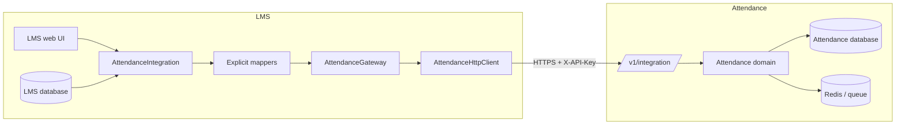
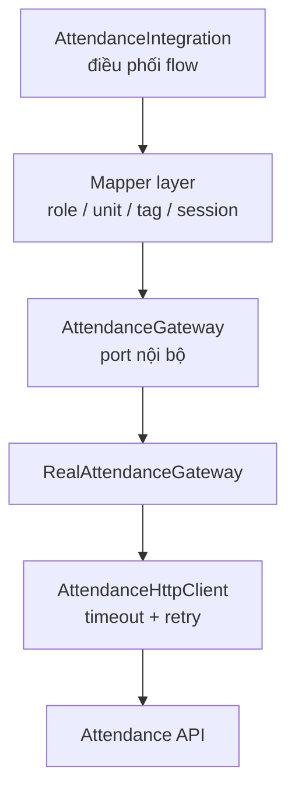
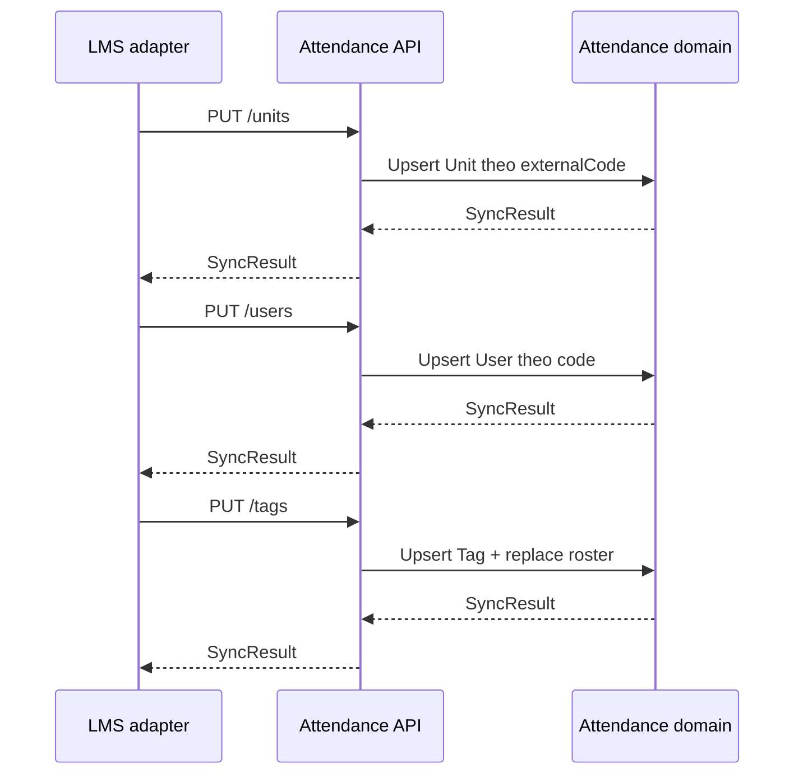
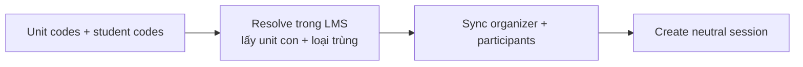
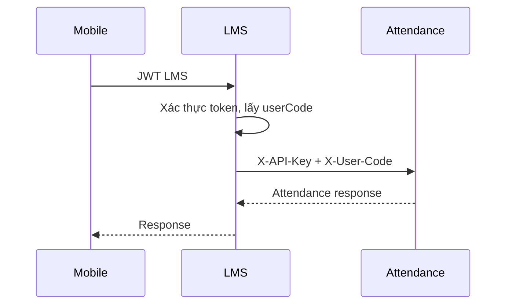

# Hướng B - GPS Attendance tách LMS qua Adapter

> Phương án mô tả hai ứng dụng độc lập kết nối qua một adapter trung tính.

## 1. Mục tiêu

Phương án này tách hai ứng dụng:

- **LMS:** nguồn sự thật về sinh viên, giảng viên, unit, class và roster.
- **Attendance:** nguồn sự thật về session, GPS, check-in, record, review và audit.

Hai hệ thống có thể được triển khai cùng hoặc khác môi trường, nhưng không dùng chung database, Redis hoặc service nội bộ.

Tài liệu này mô tả riêng phương án B để có thể đặt cạnh phương án A. Việc lựa chọn phụ thuộc vào phạm vi sở hữu dữ liệu, yêu cầu triển khai và năng lực vận hành; không có phương án tốt tuyệt đối trong mọi bối cảnh.

Trong phạm vi minh họa này, LMS chỉ là một **LMS mô phỏng tối giản**. Nó có đủ dữ liệu và màn hình cần thiết để chứng minh cách adapter đọc nguồn, ánh xạ roster và gọi Attendance, nhưng chưa phải một hệ thống quản lý đào tạo hoàn chỉnh.

LMS mô phỏng hiện tập trung vào:

- Người dùng và role nguồn.
- Cây unit.
- Class, roster và tòa nhà.
- Tạo session điểm danh chung hoặc theo class.
- Gọi các API integration của Attendance.

Các chức năng học vụ đầy đủ như học kỳ, học phần chính thức, enrollment theo kỳ, thời khóa biểu phức tạp, import dữ liệu từ hệ thống thật và báo cáo đào tạo không phải phạm vi của bản mô phỏng này. Vì vậy, phần được đánh giá ở hướng B là **ranh giới và kỹ thuật adapter**, không phải độ hoàn chỉnh của LMS.

Mục tiêu chính:

- Attendance vẫn chạy độc lập.
- LMS có thể thay đổi hoặc được thay bằng hệ thống bên ngoài.
- Logic ánh xạ chỉ nằm ở adapter.

Trong cả hướng A và hướng B, lõi Attendance là như nhau: quản lý session, GPS, check-in, record, review, audit và các cơ chế persistence cần thiết. Redis, hot path, queue và session flush là hạ tầng dùng chung của lõi này, không phải điểm khác biệt giữa hai hướng.

Điểm mạnh riêng của hướng B là giữ ranh giới học vụ bên ngoài lõi điểm danh: Attendance chỉ xử lý nghiệp vụ điểm danh và không phải hiểu mô hình học vụ hay mô hình nhân sự của từng hệ thống nguồn.

Attendance có thể chạy độc lập bằng dữ liệu và tài khoản nội bộ, hoặc kết nối qua adapter với nhiều loại hệ thống khác nhau, chẳng hạn:

- LMS hoặc SIS để lấy lớp học, giảng viên, sinh viên và roster.
- Hệ thống quản lý nhân sự để lấy phòng ban, nhân viên, người quản lý và danh sách tham gia.
- Hệ thống đào tạo nội bộ, quản lý ca hoặc cổng dịch vụ khác có nhu cầu ghi nhận hiện diện.

Mỗi nguồn chỉ cần có adapter ánh xạ dữ liệu của mình về contract trung tính `Unit`, `User`, `Tag`, `Session`, `organizer` và `participant`. Core Attendance không phải thay đổi theo từng loại nguồn.

Nói ngắn gọn, hướng B trong bản minh họa dùng một **LMS mô phỏng đơn giản** để chứng minh rằng cùng một core điểm danh có thể tái sử dụng cho nhiều hệ thống nguồn, kể cả khi các hệ thống đó không cùng công nghệ hoặc không cho phép truy cập mã nguồn.
- Attendance không chứa DTO đặc thù của LMS.

## 2. Kiến trúc tổng thể



Attendance chỉ dùng contract trung tính:

```text
Unit, User, Tag, Session
organizer, participant
externalCode, externalId
```

Attendance không biết `Course`, `Class`, `Lecturer` hoặc `Student` là khái niệm nào của hệ thống nguồn.

## 3. Phân chia trách nhiệm

| Thành phần | Trách nhiệm |
|---|---|
| LMS | Dữ liệu học vụ, auth nguồn, roster và UI nghiệp vụ |
| LMS adapter | Mapping, sync, gọi Attendance và xử lý lỗi kết nối |
| Attendance integration port | API key, validate contract, external reference |
| Attendance domain | GPS, session, check-in, record, review, audit |
| Mobile proxy | Xác thực LMS token rồi chuyển identity trung tính |

Ranh giới này được mô tả trong `docs/conventions/integration-boundary.md`.

## 4. Các lớp adapter LMS



### `AttendanceIntegration`

Lớp điều phối:

- Đồng bộ theo thứ tự `Unit -> User -> Tag -> Session`.
- Resolve participant từ unit hoặc mã sinh viên.
- Dừng flow nếu sync có `failed[]`.
- Không chứa chi tiết `fetch`.

### Explicit mappers

Mỗi mapper tạo contract mới, không spread nguyên object LMS.

```text
LMS lecturer -> Attendance organizer
LMS student  -> Attendance participant
LMS admin    -> từ chối sync
LMS Class    -> Attendance Tag
LMS Session  -> AttendanceSessionInput
```

### `AttendanceGateway`

Gateway tách nghiệp vụ LMS khỏi HTTP:

```ts
interface AttendanceGateway {
  syncUnits(units): Promise<SyncResult>;
  syncUsers(users): Promise<SyncResult>;
  syncTags(tags): Promise<SyncResult>;
  createSession(input): Promise<SessionView>;
  getSession(externalId): Promise<SessionView>;
  getRecords(externalId): Promise<RecordsView>;
  cancelSession(externalId): Promise<SessionView>;
}
```

`MockAttendanceGateway` chỉ dành cho test/demo. Production dùng `RealAttendanceGateway` và không fallback sang mock khi Attendance lỗi.

### `AttendanceHttpClient`

Client HTTP chịu trách nhiệm:

- Gắn `X-API-Key` server-side.
- Timeout mặc định 5 giây.
- Retry network error, timeout, `429` và `5xx`.
- Không retry lỗi nghiệp vụ `4xx`.
- Chuẩn hóa lỗi thành `AttendanceApiError`.
- Kiểm tra response envelope `success/data`.

## 5. Mapping từ LMS sang Attendance

| Dữ liệu LMS | Contract Attendance | Ý nghĩa |
|---|---|---|
| `Unit.code` | `externalCode` | Mã đơn vị nguồn |
| `lecturer` | `organizer` | Người tổ chức |
| `student` | `participant` | Người tham gia |
| `Class` | `Tag` | Nhóm organizer và roster |
| `LmsSession` | `SessionInput` | Yêu cầu tạo session |
| LMS numeric ID | Không gửi | Attendance tự quản lý ID nội bộ |

Tag ví dụ:

```json
{
  "externalCode": "INT101",
  "name": "INT101 · Nhập môn lập trình",
  "organizerCode": "GV001",
  "participantCodes": ["SV001", "SV002"]
}
```

Session ví dụ:

```json
{
  "externalId": "LMS-8c2...",
  "title": "Điểm danh buổi 1",
  "latitude": 11.9516,
  "longitude": 108.4379,
  "radius": 300,
  "openAt": "2026-11-11T10:00:00.000Z",
  "closeAt": "2026-11-11T10:45:00.000Z",
  "organizerCode": "GV001",
  "participantCodes": ["SV001", "SV002"]
}
```

Không gửi `classId`, `buildingId` hoặc ID database của LMS.

## 6. Luồng đồng bộ directory



Thứ tự này bảo đảm:

```text
Unit tồn tại trước User
User tồn tại trước Tag
Tag/User tồn tại trước Session
```

## 7. Luồng tạo session

### Session theo class

```text
LMS UI
  -> chọn class và thời gian
  -> adapter đọc class + roster
  -> sync Unit, User, Tag
  -> map LmsSession thành SessionInput
  -> POST /v1/integration/sessions
```

### Session chung theo Unit hoặc mã sinh viên



Mã giả:

```text
participants = resolve(unitCodes, individualStudentCodes)
syncUnits()
syncUsers(organizer + participants)
createSession(organizerCode, participants)
```

Attendance không biết người dùng chọn roster qua tab nào. Nó chỉ nhận danh sách mã cuối cùng.

## 8. `externalId` và idempotency

Session được liên kết như sau:

```text
LMS externalId
    <-> IntegrationSessionLink.externalId
    <-> AttendanceSession.id
```

Attendance tạo fingerprint từ payload đã chuẩn hóa:

```text
cùng externalId + cùng payload
    -> trả session cũ

cùng externalId + payload khác
    -> Conflict
```

Điều này bảo vệ flow khi request bị timeout sau khi Attendance đã ghi thành công.

Huỷ session qua integration cũng idempotent: gọi lại session đã `cancelled` sẽ trả trạng thái hiện tại.

## 9. Mobile adapter

Mobile không gửi JWT LMS sang Attendance.



LMS chỉ proxy allowlist:

```text
GET  /v0/users/me
GET  /v0/attendance-sessions/me
POST /v0/attendance/check-in
```

Không có generic proxy và không chuyển credential nguồn xuống Attendance.

## 10. Attendance integration port

Attendance mở inbound port:

```text
PUT  /v1/integration/units
PUT  /v1/integration/users
PUT  /v1/integration/tags
POST /v1/integration/sessions
GET  /v1/integration/sessions/{externalId}
GET  /v1/integration/sessions/{externalId}/records
POST /v1/integration/sessions/{externalId}/cancel
```

Mỗi request đi qua `IntegrationApiKeyGuard`:

1. Đọc `INTEGRATION_API_KEY` từ config Attendance.
2. Đọc `X-API-Key` từ request.
3. So sánh constant-time.
4. Từ chối nếu thiếu hoặc sai key.

Sau guard, `IntegrationService` validate DTO, resolve external code và gọi domain service hiện có.

## 11. Điểm mạnh

- Ranh giới sở hữu dữ liệu rõ.
- Attendance có thể chạy độc lập.
- Không phụ thuộc mã nguồn hoặc database LMS.
- Dễ thay LMS hoặc thêm SIS khác.
- Giảm coupling migration và database.
- Adapter có thể in-process hoặc tách thành connector service.
- API key và credential được giữ ở server.
- Có thể bổ sung queue/outbox ở adapter mà không đổi Attendance domain.

## 12. Điểm yếu và rủi ro

- Có network hop và lỗi kết nối giữa hai server.
- Không có transaction xuyên hệ thống.
- Sync roster có thể trễ nếu LMS chưa gửi thay đổi.
- Retry phải đi kèm `externalId` và idempotency.
- Báo cáo liên quan course cần lấy dữ liệu từ LMS hoặc lưu mapping phù hợp.
- Nhiều service hơn nên cần quản lý URL, key, health check và log riêng.

## 13. Hai cách deploy adapter

### In-process trong LMS

```text
LMS application
├─ Academic services
├─ LMS database
└─ Attendance adapter
   └─ gọi Attendance API
```

Phù hợp khi kiểm soát mã nguồn LMS và muốn vận hành ít service.

### Connector service riêng

```text
Source LMS / SaaS
        |
        v
Connector service
  - source client
  - mapper
  - outbox / queue
  - retry / dead letter
        |
        v
Attendance Integration API
```

Phù hợp khi nguồn là SaaS, chỉ cung cấp API/webhook hoặc có nhiều nguồn cần kết nối.

Hai cách deploy dùng cùng contract. Chỉ thay đổi nơi chạy adapter, không thay đổi trách nhiệm của Attendance.

## 14. Khi phương án B phù hợp hơn

Phương án B phù hợp hơn khi:

- LMS có thể là hệ thống ngoài hoặc không kiểm soát được mã nguồn.
- Attendance cần độc lập với hệ thống học vụ.
- Có khả năng thay LMS hoặc tích hợp nhiều nguồn.
- Muốn tách release cycle của học vụ và điểm danh.
- Muốn giữ Attendance như một dịch vụ điểm danh dùng lại được.

## 15. Giới hạn của phương án và hướng mở rộng

Nếu triển khai adapter theo kiểu synchronous, luồng sẽ là:

```text
LMS request -> gọi Attendance -> trả kết quả
```

Chưa có:

- Outbox/worker để retry bền vững sau khi process restart.
- Contract test chạy trực tiếp giữa hai server thật.
- Runtime schema validation đầy đủ cho mọi field response.
- Ownership model riêng cho nhiều connector.

Khi cần triển khai lớn hơn, có thể đưa adapter ra một connector service riêng mà không đổi Attendance API.

## 16. Tóm tắt một câu

```text
Thiết kế B tối ưu cho ranh giới hệ thống,
khả năng thay nguồn và triển khai Attendance độc lập.
```
