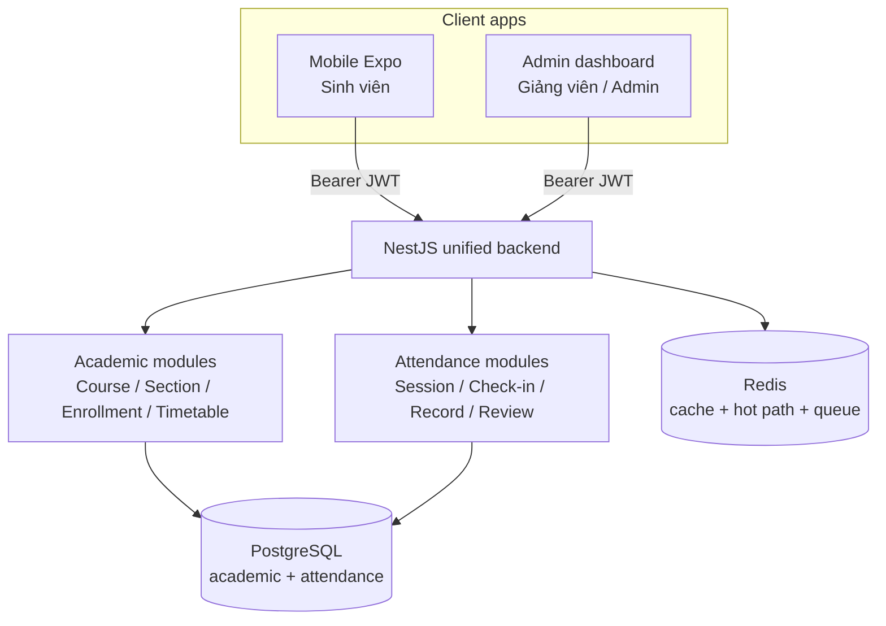
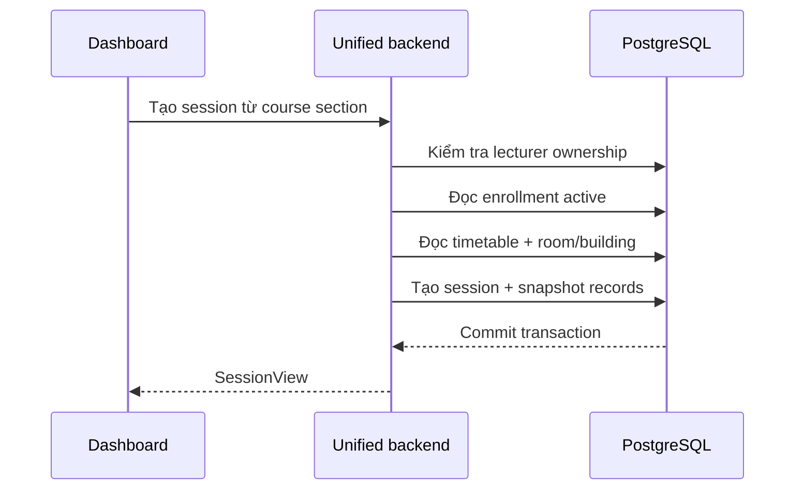
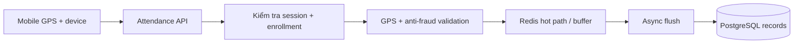

# Hướng A - GPS Attendance hợp nhất với học vụ

> Phương án mô tả một hệ thống duy nhất quản lý đồng thời học vụ và điểm danh.

## 1. Mục tiêu

Đây là một hệ thống thống nhất cho một trường hoặc một tổ chức giáo dục. Một backend quản lý cả dữ liệu học vụ và nghiệp vụ điểm danh.

Tài liệu này mô tả riêng phương án A để có thể đặt cạnh phương án B. Việc lựa chọn phụ thuộc vào phạm vi sở hữu dữ liệu, yêu cầu triển khai và năng lực vận hành; không có phương án tốt tuyệt đối trong mọi bối cảnh.

Hệ thống phục vụ ba nhóm chính:

- **Sinh viên:** xem phiên được phân công, check-in GPS và xem lịch sử.
- **Giảng viên:** tạo, quản lý và theo dõi phiên điểm danh.
- **Admin:** quản trị người dùng, lớp học phần, địa điểm và toàn bộ phiên.

Mục tiêu kỹ thuật:

- Luồng tạo session và snapshot roster có thể nằm trong cùng transaction.
- Check-in phản hồi nhanh trong thời điểm burst đầu giờ học.
- Dữ liệu học vụ, điểm danh và báo cáo truy vấn được trong cùng hệ thống.

Trong cả hướng A và hướng B, lõi Attendance là như nhau: quản lý session, GPS, check-in, record, review, audit và các cơ chế persistence cần thiết. Redis, hot path, queue và session flush cũng thuộc lõi dùng chung, không phải điểm khác biệt giữa hai hướng.

Điểm mạnh riêng của hướng A là tính thống nhất ở phần học vụ: người dùng, lớp học phần, lịch học, roster và phiên điểm danh được quản lý trong cùng một mô hình. Hệ thống có thể đưa ra quyết định nghiệp vụ nhanh vì không phải đồng bộ phần học vụ qua một hệ thống trung gian, đồng thời dễ tạo các báo cáo kết hợp giữa dữ liệu học vụ và kết quả điểm danh.

Nói ngắn gọn, hướng A phù hợp với bài toán **một nền tảng giáo dục thống nhất**, nơi đơn vị triển khai làm chủ toàn bộ dữ liệu và vòng đời phần mềm.

## 2. Kiến trúc tổng thể



Các nhóm model thường nằm trong cùng backend:

```text
Account / User
AcademicTerm / Course / CourseSection
ClassEnrollment / TimetableSlot
Building / Room
AttendanceSession / AttendanceRecord / Attempt / History
AuditLog / Device / Notification
```

## 3. Phân chia module

| Nhóm | Trách nhiệm |
|---|---|
| `auth`, `account`, `users` | Đăng nhập, JWT, hồ sơ và role |
| `course`, `course-section` | Danh mục học phần và lớp học phần |
| `enrollment` | Roster và trạng thái ghi danh |
| `timetable`, `location-registry` | Lịch học, tòa nhà, phòng học |
| `attendance-sessions` | Tạo, đóng, hủy, truy vấn phiên |
| `attendance-check-in` | Check-in, attempt, device |
| `attendance-validation` | GPS, mock location, integrity, review |
| `attendance-record` | Kết quả, lịch sử và báo cáo |
| `common`, `health`, `logging` | Hạ tầng dùng chung |

Một backend duy nhất có thể dùng module boundary để giảm phụ thuộc, nhưng các module vẫn chia sẻ database và cùng release cycle.

## 4. Nguồn dữ liệu và quyền sở hữu

Trong thiết kế này, một hệ thống duy nhất sở hữu cả hai nhóm dữ liệu:

```text
Academic data
  - course, section, enrollment, timetable, room

Attendance data
  - session, record, attempt, review, audit
```

`User`, `CourseSection`, `ClassEnrollment` và `AttendanceSession` có thể liên kết trực tiếp bằng foreign key nội bộ.

Điều này làm truy vấn nghiệp vụ thuận tiện, nhưng cũng khiến hai domain phụ thuộc vào cùng schema và migration.

## 5. Luồng tạo session



Mã giả:

```text
section = findSection(sectionId)
assert owns(organizer, section)
roster = findActiveEnrollments(section)
location = resolveBuildingAndRoom(section)

transaction:
  session = createAttendanceSession(section, location)
  createAbsentRecords(session, roster)

return session
```

Không có HTTP adapter giữa academic domain và attendance domain vì cả hai nằm trong cùng application boundary.

## 6. Luồng check-in



Một request check-in thường đi qua:

1. Xác thực JWT.
2. Kiểm tra session đang mở.
3. Kiểm tra user có record trong session.
4. Kiểm tra số lần thử và device trùng.
5. Tính khoảng cách Haversine và đánh giá độ tin cậy.
6. Trả `VALID`, `REVIEW` hoặc `REJECTED`.
7. Ghi record và history theo cơ chế persistence của hệ thống.

## 7. Kiến trúc hiệu năng

Lõi Attendance dùng chung cho hai hướng có thể tổ chức Redis cho các đường nóng:

- Buffer record điểm danh.
- Async staging queue cho attempt, device và audit event.
- Distributed job scheduler.
- Two-phase flush từ Redis xuống PostgreSQL khi session kết thúc.

Ý tưởng tổng quát:

```text
HTTP check-in
  -> xác thực nhanh trong Redis/Lua
  -> trả kết quả
  -> stage dữ liệu phụ trợ
  -> worker ghi batch xuống PostgreSQL
```

Mục tiêu là không để việc ghi nhiều bảng nhật ký làm chậm hot path check-in. Đây là năng lực chung của lõi Attendance, không phải một đặc điểm chỉ có ở hướng A.

## 8. Chuẩn role và API

Trong mô hình này, client thường dùng các role ngữ cảnh:

```text
student  -> sinh viên
lecturer -> giảng viên
admin    -> quản trị viên
```

API dùng JWT trực tiếp giữa client và backend. Shared package chứa:

- `ApiResponse<T>`.
- DTO và type dùng chung.
- Error code theo domain.
- HTTP client hoặc helper dùng chung.

## 9. Điểm mạnh

- Một backend và một database dễ chạy cho một trường.
- Tạo session và snapshot roster có thể atomic trong transaction.
- Truy vấn báo cáo course, enrollment và attendance đơn giản.
- Ít network hop, độ trễ thấp.
- Ownership của giảng viên và lớp học phần dễ kiểm tra.
- Dễ xây luồng nghiệp vụ đầy đủ khi team kiểm soát toàn bộ code.

## 10. Điểm yếu và rủi ro

- Coupling cao giữa học vụ và điểm danh.
- Migration academic có thể ảnh hưởng check-in.
- Một lỗi nghiêm trọng ở module học vụ có thể ảnh hưởng toàn backend.
- Database lớn, khó tách thành sản phẩm độc lập.
- Khó tích hợp với LMS/SIS đóng hoặc SaaS không cho truy cập database.
- Thay đổi mô hình học vụ có thể kéo theo thay đổi attendance API hoặc report.
- Release cycle của academic và attendance bị gộp.

## 11. Khi phương án A phù hợp hơn

Phương án A phù hợp hơn khi:

- Một team kiểm soát toàn bộ hệ thống và database.
- Chỉ cần phục vụ một trường hoặc một domain học vụ ổn định.
- Báo cáo học vụ - điểm danh là chức năng cốt lõi và cần truy vấn trực tiếp.
- Ưu tiên transaction nội bộ và độ trễ thấp hơn khả năng thay nguồn.
- Có đủ năng lực vận hành database/schema lớn.

## 12. Tóm tắt một câu

```text
Thiết kế A tối ưu cho một sản phẩm hợp nhất,
trong đó học vụ và điểm danh cùng thuộc một backend và một đội sở hữu.
```
