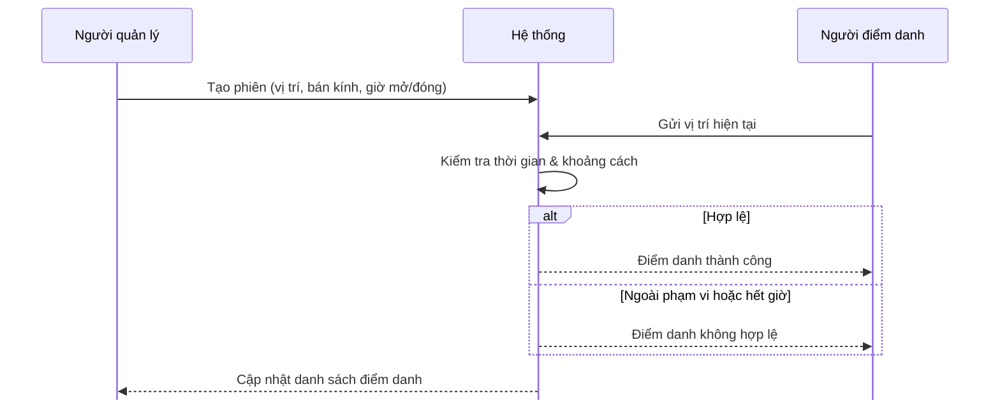
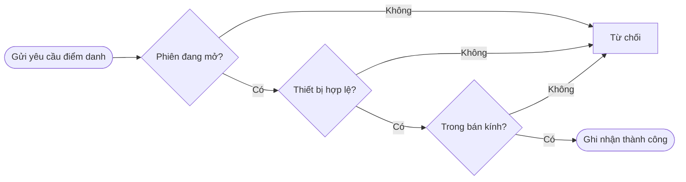
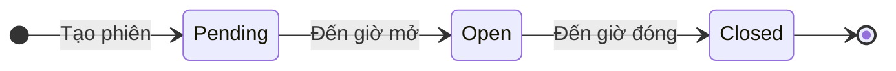
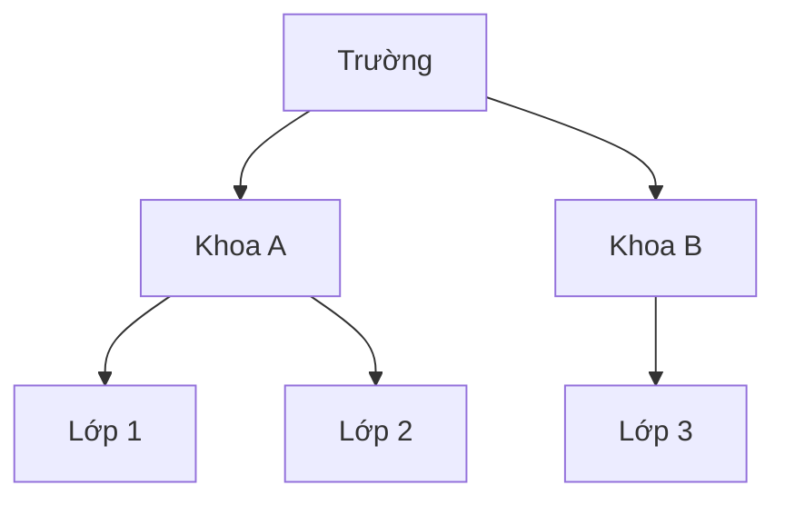
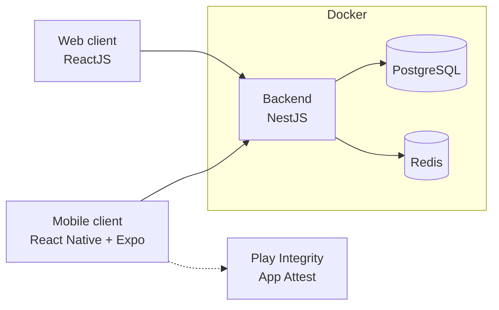

## Đồ án chuyên ngành

# Hệ thống điểm danh dựa trên tín hiệu GPS

> Điểm danh nhanh, chính xác, đúng người đúng thời điểm

`📍 Geofencing` `⏱️ Theo phiên` `🗂️ Theo đơn vị`

Nhóm 9 · 20/09/2026

---
class: cards cols-3 center team
---

## Đội ngũ

# Giới thiệu nhóm

> 🎓 Giảng viên hướng dẫn: **TS. Trần Nhật Quang**

-  **Phan Lê Xuân Mạnh** MSSV: 2312686 *Trưởng nhóm*
-  **Mai Quý Phước** MSSV: 2312716 *Thành viên*
-  **Phạm Nguyễn Ngọc Phước** MSSV: 2312718 *Thành viên*

---
class: agenda
---

## Nội dung

# Nội dung trình bày

1. Bối cảnh và giải pháp
2. Tính năng
3. Thiết kế hệ thống
4. Công nghệ và giao diện
5. Demo
6. Tổng kết

---

## Bối cảnh

# Vấn đề hiện tại

- **📝 Thủ công, tốn thời gian** Gọi tên, ký giấy mỗi buổi mất thời gian và dễ nhầm lẫn.
- **🧑‍🤝‍🧑 Điểm danh hộ** Người vắng vẫn được báo có mặt, khó xác minh.
- **📊 Dữ liệu phân tán** Danh sách rải rác giấy và Excel, khó tổng hợp, thống kê.
- **🏢 Tổ chức nhiều cấp** Khoa, lớp, nhóm lồng nhau, khó quản lý đồng bộ.

---
class: cards cols-2
---

## Mục tiêu

# Mục tiêu và phạm vi

- **🎯 Mục tiêu** Số hóa điểm danh, đảm bảo người điểm danh có mặt thật, đúng nơi, đúng giờ.
- **👥 Đối tượng** Admin, người quản lý phiên và người dùng điểm danh.
- **📱 Nền tảng** Web và mobile (iOS, Android).
- **🚧 Ngoài phạm vi** Sinh trắc học, điểm danh offline, tích hợp SSO và thời khóa biểu của trường.

---
class: cards cols-3
---

## Giải pháp

# Điểm danh dựa trên vị trí địa lý

- **📍 Xác thực vị trí** Chỉ điểm danh được khi nằm trong bán kính cho phép của phiên.
- **⏱️ Đóng mở tự động** Phiên tự mở và đóng theo thời gian đã cài đặt.
- **🛡️ Toàn vẹn thiết bị** Xác minh thiết bị và ứng dụng hợp lệ bằng App Integrity.
- **🗂️ Quản lý tập trung** Phân nhóm người dùng theo đơn vị và thẻ (tag).
- **📡 Theo dõi thời gian thực** Xem danh sách điểm danh ngay khi phiên đang diễn ra.
- **🔐 Phân quyền theo vai trò** Admin, quản lý và người dùng có chức năng riêng.

---
class: cards cols-3
---

## Tính năng

# Tính năng chính

> Mỗi vai trò được cung cấp **giao diện và nhóm chức năng riêng**, phù hợp với nhu cầu sử dụng.

- **🛡️ Quản trị viên**
  - Quản lý tài khoản và người dùng
  - Quản lý đơn vị nhiều cấp
  - Phân quyền vai trò
  - Khóa / mở khóa tài khoản
- **🧑‍🏫 Quản lý**
  - Tạo phiên: vị trí, bán kính, thời gian
  - Quản lý thẻ để nhóm người dùng
  - Theo dõi điểm danh theo thời gian thực
  - Xem kết quả từng phiên
- **🎓 Người dùng**
  - Đăng nhập bằng tài khoản
  - Xem các phiên đang mở
  - Điểm danh bằng vị trí hiện tại
  - Xem lại lịch sử điểm danh

---

## Thiết kế hệ thống

# Quy trình điểm danh

---

## Thiết kế hệ thống

# Cơ chế xác thực điểm danh

---

## Thiết kế hệ thống

# Vòng đời của một phiên

Phiên tự mở và tự đóng theo thời gian đã cài đặt, không cần thao tác thủ công.

---

## Thiết kế hệ thống

# Mô hình dữ liệu

  

---
layout: two-cols
---

## Thiết kế hệ thống

# Đơn vị và thẻ

::right::

### Đơn vị

Cấu trúc phân cấp từ trường, khoa đến lớp. Mỗi người dùng thuộc một đơn vị cụ thể.

### Thẻ

Nhóm người dùng linh hoạt, không phụ thuộc vào cấu trúc đơn vị. Một người có thể được gắn nhiều thẻ.

---

## Thiết kế hệ thống

# Kiến trúc hệ thống

---
class: cards cols-3 center
---

## Công nghệ

# Công nghệ sử dụng

- **Web client**
  \
  ReactJS
- **Mobile client**
   \
  React Native + Expo
- **Backend**
  \
  NestJS
- **Database**
  \
  PostgreSQL
- **Cache**
  \
  Redis
- **Containerization**
  \
  Docker

---

## Giao diện

# Web & Mobile

### Web client
- Quản lý người dùng, đơn vị, thẻ
- Tạo và theo dõi phiên điểm danh
- Xem kết quả từng phiên

### Mobile client
- Xem các phiên đang mở
- Điểm danh bằng vị trí hiện tại
- Xem lại lịch sử điểm danh

---

---
class: cards cols-3
---

## Đội ngũ

# Phân công công việc

- **Phan Lê Xuân Mạnh**
  - Phát triển Backend & API
  - Thiết kế cơ sở dữ liệu & hệ thống

- **Mai Quý Phước**
  - Phát triển Admin Dashboard
  - Quản lý phiên điểm danh & giao diện quản trị

- **Phạm Nguyễn Ngọc Phước**
  - Phát triển Mobile App
  - Tích hợp GPS & chức năng điểm danh

---
class: cards cols-3
---

## Tổng kết

# Kết quả và bài học

* **✅ Kết quả**

  * Hoàn thiện hệ thống điểm danh bằng GPS
  * Hoàn thiện Backend, Admin Dashboard và Mobile App

* **🧗 Khó khăn**

  * Đồng bộ dữ liệu giữa các thành phần của hệ thống
  * Xử lý xác thực và kiểm tra vị trí khi điểm danh

* **💡 Bài học**

  * Thiết kế kiến trúc rõ ràng giúp phát triển và bảo trì dễ dàng hơn
  * Cần kiểm thử từng chức năng trước khi tích hợp toàn hệ thống

---
class: cards cols-2
---

## Tương lai

# Hướng phát triển

- **📱 Ứng dụng di động** Thông báo khi phiên mở.
- **🛡️ Chống giả mạo vị trí** Phát hiện mock location.
- **📈 Báo cáo, thống kê** Theo đơn vị và thẻ.
- **📤 Xuất dữ liệu** Xuất ra Excel.

---
layout: center
class: hero text-center
---

# Cảm ơn đã lắng nghe!

> Câu hỏi & thảo luận

[GitHub Repo](https://github.com/xuanmanhneee/gps-attendance)